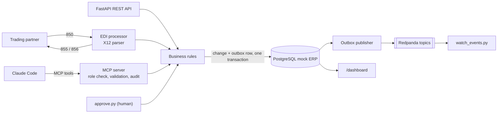

# OrderBridge: AI-Enabled Supply Chain Integration Hub

OrderBridge is an order hub for a fictional outdoor-gear distributor. Trading partners send
**X12 EDI 850 purchase orders**. OrderBridge validates them, stores orders and inventory in a
**mock ERP (PostgreSQL)**, answers with **855 acknowledgments** and **856 ship notices**, and
publishes every state change to **Redpanda (Kafka)** through a **transactional outbox**.

It also exposes the ERP to AI agents through a secure **MCP (Model Context Protocol) server**.
Claude Code can investigate at-risk orders, allocate stock, and propose replenishment. Every
call is **authorized by role, validated, and audited**. Purchases always need **human approval**.

> All companies, partners and people in this project are fictional. Everything runs locally at $0.

## The problem it solves

Supply chain teams lose hours answering "which orders will miss their ship date, and why?"
The answer spans EDI files, ERP tables and inventory systems. Giving an AI agent direct
database access is unsafe. OrderBridge shows the safe pattern. The AI gets a small set of
well-described tools, each wrapped in the same controls an integration platform puts on an
API: authorization, validation, audit, idempotency and guaranteed event delivery. The
AI can **propose** spending money but only a human can **approve** it.

## Architecture



The full diagram, event catalogue and control-by-control rationale are in
[docs/architecture.md](docs/architecture.md).

| Layer | Choice | Why |
|---|---|---|
| Language | Python 3.11+ (3.12 on this Mac) | Primary language in target job postings |
| API | FastAPI + Uvicorn | Typed, with OpenAPI docs generated at `/docs` |
| Database | PostgreSQL 16 in Docker | Mock ERP / SCM system of record |
| DB access | SQLAlchemy 2 + psycopg 3 | Standard Python ORM |
| Events | Redpanda in Docker + `confluent-kafka` | Kafka API without Kafka's setup weight |
| AI integration | Official `mcp` Python SDK (FastMCP), stdio | Connects directly to Claude Code |
| Tests | pytest | 72 tests: unit, API, EDI, MCP over stdio, real broker |

## Prerequisites

| Tool | Notes |
|---|---|
| Docker with Compose v2 | Runs Postgres, Redpanda and Redpanda Console. See the macOS 12 note below. |
| Python 3.11 or newer | This Mac's `.venv` uses Python 3.12. See the macOS 12 note below. |
| Node.js | Only for the optional MCP Inspector (`npx`). |
| Claude Code | The AI agent used for the demo. |

**macOS 12 Monterey notes.** Recent Docker Desktop releases need macOS 14 or newer. On Monterey,
install an older Docker Desktop such as 4.34.3 from Docker's release notes, or upgrade macOS.
`confluent-kafka` has no Python 3.13 wheel for macOS 12, so the virtual environment uses Python 3.12.
To recreate it:

```bash
uv python install 3.12        # or install Python 3.12 from python.org
~/.local/share/uv/python/cpython-3.12-macos-x86_64-none/bin/python3.12 -m venv .venv
.venv/bin/pip install -r requirements.txt
```

## Run it in 5 minutes

```bash
cd ~/OrderBridge-Enterprise-AI-MCP-Project

# 1. Settings (already done on this machine; .env is git-ignored)
cp -n .env.example .env

# 2. Infrastructure: Postgres + Redpanda + Redpanda Console
docker compose up -d
docker compose ps            # wait until postgres and redpanda show "healthy"

# 3. Python environment (already done on this machine)
python3.12 -m venv .venv && .venv/bin/pip install -r requirements.txt

# 4. Start the API, EDI watcher and outbox publisher together (Ctrl+C stops all three)
.venv/bin/python scripts/run_all.py

# 5. In a second terminal, watch events stream live
.venv/bin/python scripts/watch_events.py
```

Then open:

| URL | What |
|---|---|
| http://localhost:8000/dashboard | Live dashboard (refreshes every 3 seconds) |
| http://localhost:8000/docs | Interactive API docs (Swagger UI) |
| http://localhost:8080 | Redpanda Console: topics and messages |

Each process can also run on its own:

```bash
.venv/bin/uvicorn orderbridge.api.main:app --reload --port 8000   # API
.venv/bin/python -m orderbridge.edi.watcher                        # EDI watcher (--once to run once)
.venv/bin/python -m orderbridge.events.publisher                   # outbox publisher
```

## See it working, phase by phase

### Phase 1: infrastructure and mock ERP

`docker compose up -d` loads `db/schema.sql` and `db/seed.sql` automatically on first start.
Connect any SQL client (TablePlus, DBeaver, VS Code) to `localhost:5432`, database
`orderbridge`, with the user and password from `.env`. Or use psql inside the container:

```bash
docker exec -it orderbridge-postgres psql -U orderbridge -c "select status, count(*) from orders group by 1;"
```

The seed deliberately contains these demo scenarios:

| Scenario | Data |
|---|---|
| Low stock | TENT-2P-ULT, FUEL-230, FILTER-SQZ, LAMP-HEAD are at or below reorder point |
| At risk | 5 orders ship within 2 days and are not allocated |
| Short | PK-10005 needs 30 x TENT-2P-ULT, but only 12 are available |

Seed dates are relative to the day the database was seeded. On a later day, refresh them:

```bash
.venv/bin/python scripts/reset_db.py
```

### Phase 2: REST API and idempotency

In http://localhost:8000/docs, try `GET /orders`, `GET /orders/{order_id}` and
`GET /inventory/{sku}`. Then show idempotency from the terminal:

```bash
BODY='{"partner_code":"PEAK","po_number":"PK-API-0001","requested_ship_date":"2030-01-15","lines":[{"sku":"BOTTLE-1L","qty":24,"unit_price":28.80}]}'
# Same key + same body twice: one order, identical responses (second has Idempotent-Replayed: true)
curl -i -X POST localhost:8000/orders -H 'Content-Type: application/json' -H 'Idempotency-Key: demo-1' -d "$BODY"
curl -i -X POST localhost:8000/orders -H 'Content-Type: application/json' -H 'Idempotency-Key: demo-1' -d "$BODY"
# Same key + different body: 409 Conflict
curl -i -X POST localhost:8000/orders -H 'Content-Type: application/json' -H 'Idempotency-Key: demo-1' -d "${BODY/24/25}"
# Validation: unknown SKU or qty <= 0 gives a clear 422
curl -s -X POST localhost:8000/orders -H 'Content-Type: application/json' -H 'Idempotency-Key: demo-2' \
  -d '{"partner_code":"PEAK","po_number":"X1","lines":[{"sku":"NOPE","qty":1,"unit_price":1}]}'
```

### Phase 3: EDI 850 in, 855 and 856 out

With the watcher running, drop the samples in:

```bash
cp edi/samples/850_valid_PEAK.edi edi/inbound/        # order created, 855 "AD" in edi/outbound/
cp edi/samples/850_unknown_sku_SWIFT.edi edi/inbound/ # 855 "AC": CANOE-16FT line rejected (ACK*IR)
cp edi/samples/850_malformed_GRANITE.edi edi/inbound/ # moved to edi/error/ with a .reason.txt
cp edi/samples/850_valid_PEAK.edi edi/inbound/again.edi  # duplicate PO, rejected to edi/error/
```

The parser checks that the ISA is exactly 106 characters with the correct element widths,
that SE01 matches the real segment count, and that the SE/ST, GE/GS and IEA/ISA control
numbers match. To generate an **856**, allocate an order and ship it in `/docs`:
`POST /orders/{id}/allocate`, then `POST /orders/{id}/ship`. The ASN appears in `edi/outbound/`.

### Phase 4: events with the transactional outbox

Run `watch_events.py` in one terminal and drop an 850 in another. You will see
`order.received`, then `order.acknowledged`, appear within a second or two. Open Redpanda
Console to browse the `orders`, `inventory` and `approvals` topics.

**Why no event is ever lost.** The business change and its event row in the `outbox` table
commit in the same database transaction, so they cannot drift apart. If Redpanda is down,
the row waits with `published_at` empty. The publisher retries with exponential backoff
(1, 2, 4 … 60 seconds) and increments `attempts`. Try it: `docker compose stop redpanda`,
drop an 850, watch the dashboard's outbox backlog rise, then `docker compose start redpanda`.
The oldest unsent event blocks the ones behind it, so consumers never see events out of order.
Delivery is at least once, so each event carries an `event_id` for consumers to de-duplicate.

### Phase 5: MCP server, the centrepiece

Register the server with Claude Code. Run this once, from any folder:

```bash
claude mcp add orderbridge --scope user \
  --env MCP_ACTOR=brad --env MCP_ROLE=planner \
  -- /Users/bradwartman/OrderBridge-Enterprise-AI-MCP-Project/.venv/bin/python -m orderbridge.mcp_server
claude mcp list          # orderbridge should show as connected
```

Start a new Claude Code session and type `/mcp` to see its 7 tools and 1 prompt.

| Tool | Kind | What it does |
|---|---|---|
| `get_order_status(po_number)` | read | Order, lines, allocations, shipments |
| `check_inventory(sku)` | read | On hand, allocated, available per warehouse |
| `find_at_risk_orders(days=2)` | read | Unallocated orders shipping soon, with reasons |
| `list_low_stock()` | read | SKUs at or below reorder point, with a suggested quantity |
| `get_audit_log(limit=20)` | read | Recent audit trail |
| `allocate_order(po_number)` | write | All-or-nothing stock reservation, or a list of shortages |
| `propose_replenishment(sku, qty, reason)` | write | Creates a PENDING proposal. Never a purchase order. |

Roles come from `MCP_ROLE`. `viewer` may use read tools only. `planner` may use read and write
tools. A missing role defaults to `viewer`, and an unknown role is denied everything. Every
call is written to `audit_log` as OK, DENIED or ERROR.

Test the tools without an AI using the free MCP Inspector, which opens in your browser:

```bash
npx @modelcontextprotocol/inspector
```

In the Inspector, connect with these settings, then open the Tools tab and call any tool:

| Setting | Value |
|---|---|
| Transport | STDIO |
| Command | `/Users/bradwartman/OrderBridge-Enterprise-AI-MCP-Project/.venv/bin/python` |
| Arguments | `-m orderbridge.mcp_server` |
| Environment | `MCP_ACTOR=brad`, `MCP_ROLE=planner` (try `viewer` to see denials) |

### Phase 6: human approval

```bash
.venv/bin/python scripts/approve.py              # interactive: approve, reject or skip each proposal
.venv/bin/python scripts/approve.py --list
.venv/bin/python scripts/approve.py --approve 2 --as brad
```

Approval creates purchase order `RPO-000nnn`, records the approver's name, and emits
`replenishment.approved` and `purchase_order.created`. **Approval is deliberately not an MCP
tool.** This is segregation of duties: the AI can raise a requisition but cannot sign it off,
even with the planner role. The guarantee is structural, because no tool exists that could
be misused, rather than relying on a prompt telling the AI not to.

### Phase 7: live dashboard

http://localhost:8000/dashboard shows order counts, at-risk count, recent orders, low stock,
pending approvals, purchase orders, outbox backlog and the latest audit entries. New rows
flash briefly. It is one HTML file with no build tooling: `orderbridge/dashboard/dashboard.html`.

## Demo script (Claude Code with the MCP server connected)

Keep the dashboard and `watch_events.py` visible while you run these.

1. "Which orders are at risk of missing their ship date, and why?"
2. "Check inventory for the SKUs on those orders."
3. "Allocate the orders that can be fully filled." Four allocate. PK-10005 is reported short.
4. "What's low on stock? Propose replenishment for anything that would block an at-risk order."
   Claude proposes TENT-2P-ULT and tells you a human must approve it.
5. Switch to read-only and reconnect:
   ```bash
   claude mcp remove orderbridge --scope user
   claude mcp add orderbridge --scope user --env MCP_ACTOR=brad --env MCP_ROLE=viewer \
     -- /Users/bradwartman/OrderBridge-Enterprise-AI-MCP-Project/.venv/bin/python -m orderbridge.mcp_server
   ```
   Start a new Claude Code session and ask it to propose a replenishment. It is denied, and
   "Show me the audit log" shows the DENIED entry. Switch back to `planner` the same way.
6. Run `scripts/approve.py`, approve the proposal, and watch the approval events and the new
   purchase order appear in the event stream and on the dashboard.

There is also a built-in MCP prompt, `daily_risk_review`, that walks Claude through steps 1 to 4.

## Design decisions

- **Idempotency.** `POST /orders` requires an `Idempotency-Key`. The key, a SHA-256 of the
  body, and the response are stored in the same transaction as the order. A retry gets the
  original response. Reusing a key with a different body is a 409.
- **Transactional outbox.** Events are rows written with the change, then published by a
  separate process. This avoids the dual-write problem, where a DB commit succeeds and the
  publish fails (or the reverse).
- **Authorization.** Checked first, before any data is read. Least privilege by default.
- **Validation.** AI-supplied SKUs and PO numbers are checked against the ERP. Quantities
  must be positive and at most 10x the SKU's reorder quantity. One pending proposal per SKU
  stops an agent from flooding approvers.
- **Audit.** Written in its own transaction, so denied and failed calls are recorded even
  when the business transaction rolls back. MCP, REST writes, EDI files and approvals all
  share one `audit_log`.
- **Human approval.** Proposals and approvals are different tools in different channels.
- **One rules layer.** `orderbridge/services` holds every business rule. REST, EDI, MCP and
  the CLI are thin channels on top, like reusable sub-processes in an integration platform.
- **EDI error handling.** Permanent errors (bad X12, duplicate PO, unknown partner) go to
  `edi/error/` with a reason file. Transient errors (database down) leave the file in
  `inbound/` for the next poll. 855s and 856s are written only after the commit succeeds.
- **All-or-nothing allocation.** Inventory rows are locked with `SELECT … FOR UPDATE`, so two
  allocations cannot promise the same units.

## What I would add for production

- **Identity:** OAuth 2.1 for the MCP server (the MCP authorization spec) and for the REST
  API, with roles from the identity provider instead of environment variables.
- **Approvals:** a four-eyes rule (approver cannot be the proposer), approval limits by
  amount, and approvals in a workflow tool or ticketing system.
- **Platform:** Kubernetes with separate deployments for API, EDI and publisher; managed
  Postgres and Kafka; secrets in a vault.
- **Observability:** OpenTelemetry tracing across REST, MCP and events; Prometheus metrics;
  alerts on outbox backlog, EDI error-folder growth, and DENIED spikes.
- **Events:** a schema registry, more partitions keyed by PO, dead-letter topics, and CDC
  (Debezium) in place of a polling publisher.
- **EDI:** AS2 or SFTP transport, 997 functional acknowledgments, and partner-specific maps.
- **AI safety:** per-tool rate limits, and an evaluation suite of prompts the agent must
  handle correctly before a release.

## Tests

```bash
.venv/bin/python -m pytest
```

Tests need Postgres running (`docker compose up -d`). They use a separate `orderbridge_test`
database, created automatically, so they never touch your demo data. The real-broker test is
skipped if Redpanda is not running. Coverage includes the X12 parser, 855/856 generation, the
folder watcher, idempotency, validation, outbox ordering and backoff, MCP authorization and
audit, an end-to-end MCP session over stdio, the approval CLI, and the dashboard.

## Project structure

```
db/                    schema.sql, seed.sql (loaded by Docker on first start)
edi/                   inbound/ outbound/ processed/ error/ samples/
orderbridge/
  config.py db.py models.py audit.py
  services/            business rules: orders, inventory, replenishment
  api/                 FastAPI app, routers, idempotency
  edi/                 x12.py parser, handler_850, generate_855, generate_856, watcher
  events/              outbox.py, publisher.py, consumer.py
  mcp_server/          server.py (tools), auth.py, validation.py
  dashboard/           router.py, dashboard.html
scripts/               run_all.py, approve.py, watch_events.py, reset_db.py
tests/                 pytest suite
docs/                  architecture.md
```

## Troubleshooting

| Symptom | Fix |
|---|---|
| `Cannot connect to the Docker daemon` | Start Docker Desktop and wait for it to finish starting. |
| `port is already allocated` on 5432 | Another Postgres is running. Set `POSTGRES_PORT=5433` in `.env`, then `docker compose up -d`. |
| `port is already allocated` on 8080 | Set `REDPANDA_CONSOLE_PORT=8081` in `.env`. |
| `Set POSTGRES_PASSWORD in .env` | Run `cp .env.example .env`. |
| Tests are all skipped | Postgres is not running. Run `docker compose up -d`. |
| No at-risk orders | Seed dates have aged. Run `scripts/reset_db.py`. |
| Changed `schema.sql` but nothing happened | Init scripts run only on a new volume. Use `docker compose down -v` or `scripts/reset_db.py`. |
| Claude Code does not list the tools | Run `claude mcp list`. Check the Python path in the add command, and start a new session. |
| MCP server errors in Claude Code | Its logs go to stderr. Run `.venv/bin/python -m orderbridge.mcp_server` by hand to see them. |
| Publisher logs `Connection refused` | Redpanda is not up yet. Events wait in the outbox and are sent once it is. |

## Notes

- The MCP SDK is pinned to 1.x, where the class is `FastMCP`. SDK 2.x renamed it `MCPServer`.
  Migrating is mostly an import change.
- Built with Claude Code as a pair programmer.
