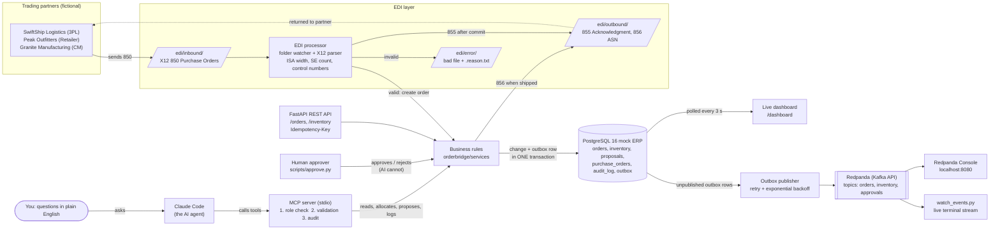

# OrderBridge architecture

OrderBridge has two front doors into the same mock ERP. Trading partners come in through
**EDI**. AI agents come in through **MCP**. Both share one set of business rules, one
database, one audit trail, and one event stream.

## Request paths

| Path | Steps |
|---|---|
| Partner order | Partner drops an 850 into `edi/inbound/`. The watcher validates the envelope, finds the partner from ISA06, and creates the order with an `order.received` outbox row in one transaction. It writes the 855 after commit, marks the order `ACKNOWLEDGED`, and moves the file to `processed/`. |
| AI question | Claude Code calls an MCP tool. The server checks the role from `MCP_ROLE`, validates the arguments, runs the service function in one transaction, and writes an audit row whether the call succeeds, fails, or is denied. |
| Replenishment | Claude proposes a buy (`PENDING`, `replenishment.proposed` event). A human runs `approve.py`, which records their name, creates the purchase order, and emits `replenishment.approved` and `purchase_order.created`. |
| Shipment | `POST /orders/{id}/ship` decrements stock, records the shipment, emits `inventory.changed` and `order.shipped`, then writes the 856 after commit. |

## Event catalogue

| Event type | Topic | Key | Emitted when |
|---|---|---|---|
| `order.received` | orders | PO number | Order created from EDI or the API |
| `order.acknowledged` | orders | PO number | 855 generated |
| `order.allocated` | orders | PO number | Stock reserved for every line |
| `order.shipped` | orders | PO number | Shipment recorded |
| `inventory.changed` | inventory | SKU | Allocation or shipment changes a warehouse row |
| `replenishment.proposed` | approvals | SKU | AI or user proposes a buy |
| `replenishment.approved` / `.rejected` | approvals | SKU | Human decision |
| `purchase_order.created` | approvals | RPO number | Approval creates a purchase order |

Every event has the same envelope: `event_id` (UUID for consumer de-duplication),
`event_type`, `occurred_at` (UTC), `key`, and `data`.

## Why each control exists

| Control | Integration analogy | Where |
|---|---|---|
| Idempotency keys | De-duplication on a retrying HTTP listener | `orderbridge/api/idempotency.py` |
| Transactional outbox | Guaranteed-delivery queue inside the ERP's own database | `orderbridge/events/outbox.py`, `publisher.py` |
| Head-of-line ordering | A FIFO queue that does not skip a failed message | `publish_batch` in `publisher.py` |
| Role check before validation | API gateway policy before the backend is touched | `orderbridge/mcp_server/auth.py` |
| Argument validation | Schema and reference-data checks on inbound documents | `orderbridge/mcp_server/validation.py` |
| Audit in its own transaction | A tracked-fields log that survives a failed process run | `orderbridge/audit.py` |
| Human-only approval | Segregation of duties: requester is never the approver | `scripts/approve.py`, no MCP tool |
| Transient vs permanent EDI errors | Retry queue vs dead-letter folder | `orderbridge/edi/watcher.py` |
